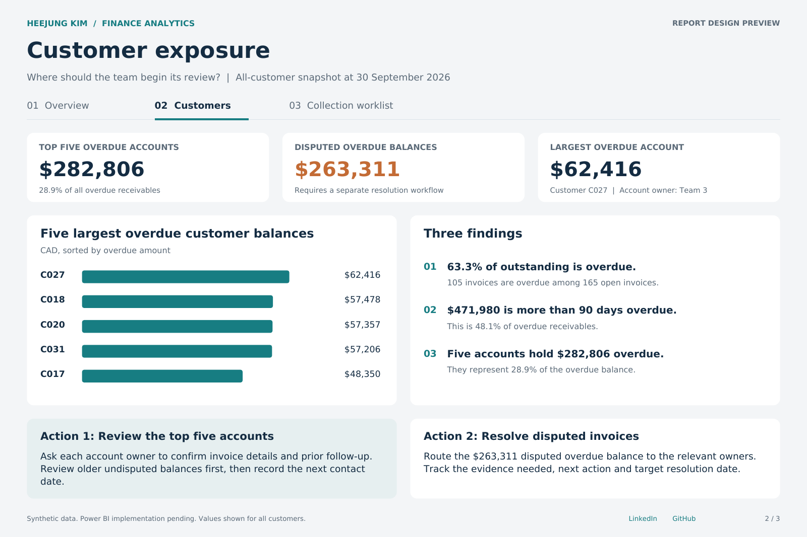
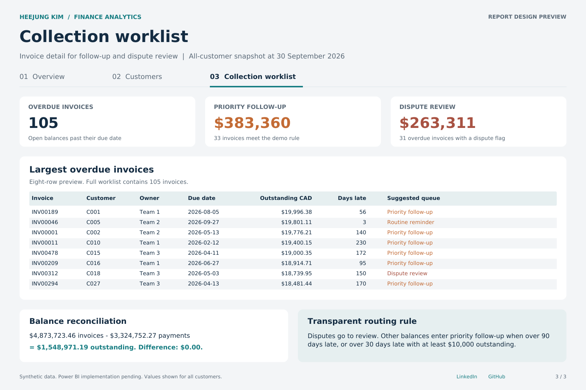

# Accounts Receivable & Collections

A finance analytics portfolio case study prepared for HeeJung Kim.

**Business question:** Which customers hold overdue balances, how old are those balances, and which invoices should a collections team review first?

**Status:** SQL analysis and reconciliation completed. Power BI build materials prepared. The interactive report and public link are pending.

## Three-page dashboard preview

The portfolio covers **all three pages** of the Accounts Receivable & Collections report design:

| 01 — Overview | 02 — Customers | 03 — Collection worklist |
|:---:|:---:|:---:|
| [](preview/01_Overview.png) | [](preview/02_Customers.png) | [](preview/03_Worklist.png) |
| Outstanding and overdue KPIs, aging bands and cash collected by month | Customer concentration, top five overdue accounts and dispute review | Invoice-level follow-up priorities, disputes and reconciliation |

**[Open the complete three-page PDF →](preview/AR_Portfolio_Preview.pdf)**

*These three images and the PDF are design previews generated from the synthetic, calculated dataset—not screenshots from a finished Power BI report. The interactive Power BI report is still being built and tested.*

## Data and scope

40 fictional customers, 480 invoices and 425 payment allocations. Reporting date: **30 September 2026**. All amounts are CAD. Source: the synthetic starter workbook generated on 16 October 2026. This is a portfolio demonstration, not employer or client data.

Invoices and payments cover January to September 2026. There are no opening receivables, credit notes, refunds, write-offs, foreign exchange or tax adjustments. Every payment is allocated to an invoice. This is one balance snapshot; monthly collections are cash receipts, not a trend of historical receivables balances.

## Three findings

1. **$980,235.72 is overdue, or 63.3% of $1,548,971.19 outstanding.** There are 105 overdue invoices among 165 open invoices.
2. **$471,979.98 is more than 90 days overdue.** This is 48.1% of overdue receivables and identifies a large group for review. Age alone does not establish default or uncollectibility.
3. **The five largest overdue customer balances total $282,805.87, or 28.9% of overdue receivables.** Customers C027, C018, C020, C031 and C017 provide a focused starting list. Across all customers, disputed overdue invoices total $263,310.83.

## Two proposed actions

1. **Review the top five overdue accounts with their account owners.** Check invoice details and prior correspondence, prioritize older undisputed balances, agree the next follow-up, and track an owner and next-contact date.
2. **Route disputed invoices to a separate resolution queue.** Review the $263,310.83 disputed overdue balance with the relevant owner before routine collection reminders. Record the reason, evidence required, next step and target resolution date.

These are proposed actions supported by the synthetic data. Their effect on collections has not been measured.

## Calculation and validation

Payments are grouped by InvoiceID before joining to invoices. This keeps one row per invoice and prevents invoice amounts from being multiplied by partial-payment rows.

- Outstanding = invoice amount minus payments dated on or before the snapshot date.
- An invoice due on the snapshot date is current. Overdue requires a positive outstanding balance and a due date before the snapshot date.
- Aging bands: Current, 1-30, 31-60, 61-90 and 91+ days.
- Fully paid invoices are excluded from aging exposure.
- The collection action categories are transparent demonstration rules, not a credit-risk prediction.

| Reconciliation | CAD |
|---|---:|
| Invoice amount | 4,873,723.46 |
| Payments through 30 September | 3,324,752.27 |
| Outstanding balance | 1,548,971.19 |
| Current plus overdue | 1,548,971.19 |
| Difference | 0.00 |

The SQL output was independently reconciled using Python Decimal calculations and compared with all 480 invoice rows in the original workbook. There were no balance or aging mismatches. Ten data checks returned zero issues. Boundary tests covered aging cutoffs, paid and partially paid invoices, and future transactions. Details: [validation result](validation/Validation_Result.json).

Power Query, DAX and Power BI interactions still need to be tested in Desktop. A successful SQL check does not establish that the report has been built correctly.

## Reproduce the SQL analysis

Requires Python 3. No additional packages are needed.

```bash
python sql/run_analysis.py
```

The script reads the CSVs, runs SQLite SQL, and writes `sql/results/ARSnapshot.csv` and `sql/results/Reconciliation.json`. Dates use ISO YYYY-MM-DD. The transformation uses integer cents for aggregation. Duplicate primary keys stop the load.

- [Snapshot transformation](sql/01_snapshot.sql)
- [Validation queries](sql/02_validation.sql)
- [Power Query transformation](powerbi/ARSnapshot.pq)
- [DAX measures](powerbi/Measures.dax)
- [Power BI build guide](docs/Power_BI_Build_Guide.md)
- [Data dictionary](docs/Data_Dictionary.md)
- [Walkthrough practice](docs/Walkthrough.md)

## Report design

1. **Overview:** outstanding and overdue balances, aging distribution and monthly cash collections.
2. **Customers:** overdue exposure by customer, concentration and proposed actions.
3. **Collection worklist:** invoice detail, owner, outstanding amount, days overdue, dispute reason and proposed action category.

The intended model uses Customers to filter ARSnapshot and Payments, and Calendar to filter Payments only. The AR snapshot remains fixed at 30 September 2026.

## Profile

[LinkedIn](https://www.linkedin.com/in/hee-jung-kim-1428781bb/) | [GitHub](https://github.com/hjkim20022)

## Technical references

- [Microsoft: star schema guidance](https://learn.microsoft.com/en-us/power-bi/guidance/star-schema)
- [Microsoft: group rows in Power Query](https://learn.microsoft.com/en-us/power-query/group-by)
- [Microsoft: merge queries](https://learn.microsoft.com/en-us/power-query/merge-queries-overview)
- [Microsoft: CALCULATE](https://learn.microsoft.com/en-us/dax/calculate-function-dax)
- [Microsoft: drill-through](https://learn.microsoft.com/en-us/power-bi/create-reports/desktop-drillthrough)
- [Microsoft: Publish to web](https://learn.microsoft.com/en-us/power-bi/collaborate-share/service-publish-to-web)