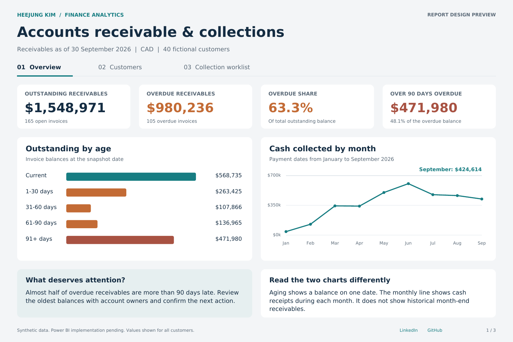

# Accounts Receivable & Collections Analytics

**HeeJung Kim** · Power BI · SQL · Python · Financial Analysis

This personal portfolio project analyzes receivables, overdue balances and collection priorities for 40 fictional customers.

## Portfolio

| Overview | Customers | Collection worklist |
|:---:|:---:|:---:|
| [](portfolio/01_Overview.png) | [](portfolio/02_Customers.png) | [](portfolio/03_Worklist.png) |

**[View the three-page portfolio PDF](portfolio/HeeJung_Kim_AR_Collections_Portfolio.pdf)**

The PDF and images are static report designs based on validated SQL outputs. Power Query and DAX source files are included; Power BI Desktop testing is not documented in this repository.

## Business findings

Reporting date: **30 September 2026**. All amounts are CAD.

- **$980,235.72 overdue:** 63.3% of the $1,548,971.19 outstanding balance. There are 105 overdue invoices among 165 open invoices.
- **$471,979.98 more than 90 days overdue:** 48.1% of overdue receivables.
- **$282,805.87 concentrated in five customers:** C027, C018, C020, C031 and C017 account for 28.9% of overdue receivables. Disputed overdue balances across all customers total $263,310.83.

## Recommendations

1. Review the five largest overdue accounts with their account owners. Confirm invoice details and prior correspondence, then assign the next action and contact date.
2. Route disputed invoices to a separate resolution queue with an owner, required evidence and target resolution date.

These recommendations use synthetic data; their effect on cash recovery has not been measured.

## Data and calculations

The [source data](data) contains 40 customers, 480 invoices and 425 payment allocations from January to September 2026. The scope excludes opening receivables, credit notes, refunds, write-offs, foreign exchange and tax adjustments.

- Payments are aggregated by InvoiceID before joining invoices, preserving one row per invoice.
- Outstanding balance equals invoice amount less payments through the reporting date.
- A positive balance is overdue when its due date precedes the reporting date.
- Aging bands are Current, 1–30, 31–60, 61–90 and 91+ days. Fully paid invoices have zero aging exposure.
- Disputed overdue invoices enter the dispute queue. Other overdue balances enter priority follow-up when more than 90 days late, or more than 30 days late with at least $10,000 outstanding. The remaining overdue invoices enter the routine reminder queue.
- Monthly cash collections use payment dates. Receivables balances use the fixed reporting date.

| Reconciliation | CAD |
|---|---:|
| Invoice amounts | 4,873,723.46 |
| Payments through 30 September | 3,324,752.27 |
| Outstanding balance | 1,548,971.19 |
| Current plus overdue | 1,548,971.19 |
| Difference | 0.00 |

## Validation

**All 10 data-quality checks and 18 boundary tests pass.** An independent Python Decimal calculation matches all 480 invoice rows, 40 customer summaries and 105 collection worklist rows.

[Validation method](validation/README.md) · [Validation results](validation/Validation_Result.json)

## Reproduce the analysis

Requires Python 3; no additional packages are needed. From the repository root:

```bash
python validation/validate_portfolio.py
```

This command runs the SQL analysis, compares its outputs with the reference files and runs the boundary tests. It writes analysis outputs to `sql/results/` and refreshes `validation/Validation_Result.json`.

For SQL output only, run `python sql/run_analysis.py`.

## Power BI configuration

- **Inputs:** Import Customers, Invoices, Payments and Calendar from the [CSV files](data), using those query names. IDs use Text, dates use Date, amounts use Fixed decimal number and sorting fields use Whole number.
- **Snapshot:** Use [ARSnapshot.pq](powerbi/ARSnapshot.pq) as a query named ARSnapshot. Its reporting date is 30 September 2026.
- **Measures:** Add each definition in [Measures.dax](powerbi/Measures.dax) as a separate measure.
- **Sort order:** Sort ARSnapshot[AgingBucket] by AgingSort and Calendar[YearMonth] by YearMonthSort.
- **Relationships:** Use one-to-many, single-direction relationships from Customers[CustomerID] to ARSnapshot[CustomerID] and Payments[CustomerID], and from Calendar[Date] to Payments[PaymentDate]. Calendar filters cash receipts only.

The unfiltered reference totals are **$1,548,971.19 outstanding** and **$980,235.72 overdue**. Desktop verification covers refresh, measures, relationships, filters and navigation.

## Repository contents

| Folder | Contents |
|---|---|
| [data](data) | Synthetic inputs and the reference invoice snapshot |
| [sql](sql) | Snapshot transformation, data-quality queries and analysis runner |
| [powerbi](powerbi) | Power Query and DAX source |
| [portfolio](portfolio) | Three report designs and the portfolio PDF |
| [validation](validation) | Validation script, results, customer summaries and collection worklist |

## Profile

[LinkedIn](https://www.linkedin.com/in/hee-jung-kim-1428781bb/) · [GitHub](https://github.com/hjkim20022)

